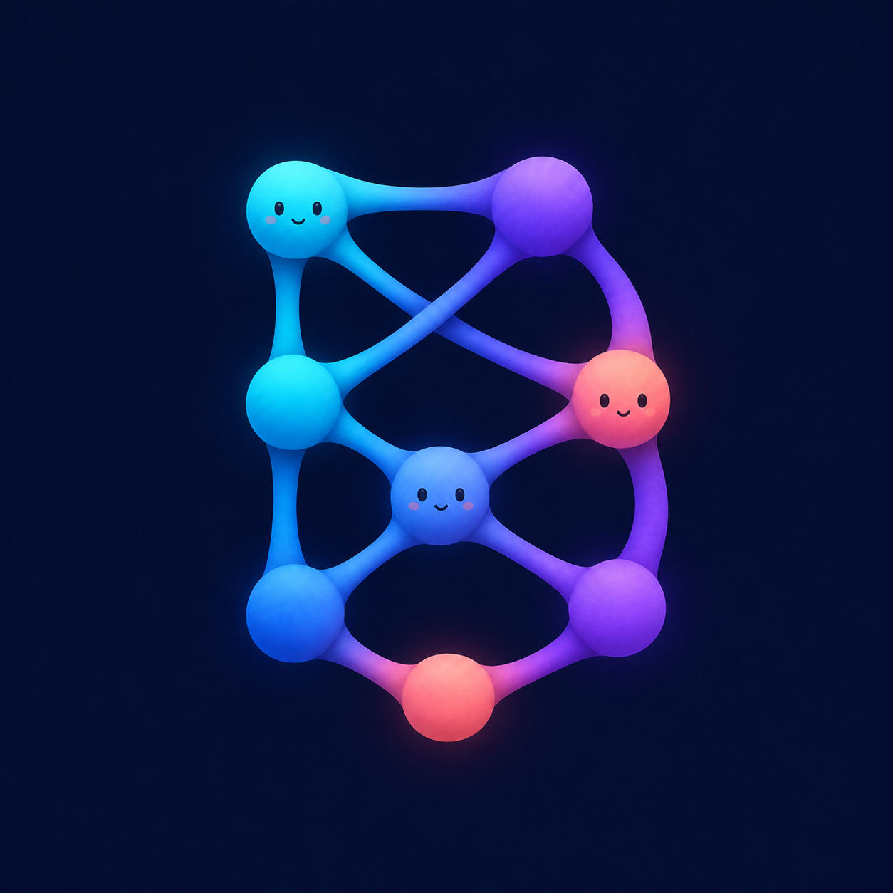

[English](https://github.com/byoridb/.github/blob/main/profile/README.md) | **한국어**

  

<h1 align="center">BYORI</h1>

<b>내 지식을 연결하고, AI와 함께 만드세요.</b>

  내 지식과 관계를 담는 개인용 온톨로지 DB, ByoriDB. 
  Byori와 Byori Studio는 이 온톨로지를 AI와 함께하는 개발과 영상 편집에 활용합니다.

  <a href="#byoridb">내 지식 연결하기</a> ·
  <a href="#byori">여러 에이전트와 개발하기</a> ·
  <a href="#byori-studio">AI와 영상 편집하기</a>

---

## ByoriDB

### 흩어진 지식을, 나만의 온톨로지로.

어떤 자료가 어떤 프로젝트에 쓰였는지, 어떤 아이디어가 어디서 이어졌는지.
따로 저장해 둔 정보도 관계를 연결하면 함께 찾아볼 수 있습니다.

ByoriDB는 내 컴퓨터에서 사용하는 개인용 온톨로지 데이터베이스입니다.
내가 쓰는 개념과 관계를 정의하고, 자료·아이디어·프로젝트를 연결해 보세요.
규칙에 따라 새로운 관계를 추론하고, 그 근거까지 확인할 수 있습니다.

[ByoriDB로 나만의 온톨로지 만들기 →](https://github.com/byoridb/byoridb)

## Byori

### 여러 코딩 에이전트와, 한곳에서 개발하세요.

Claude Code에는 새 기능을, Codex에는 다른 버그 수정을.
작업에 맞는 에이전트를 골라 동시에 진행하세요.

Byori는 ByoriDB를 기반으로 만든 macOS용 멀티 에이전트 개발 도구입니다.
프로젝트별로 작업과 터미널을 정리하고, 작업마다 별도 Git 워크트리를 만들어
각 작업의 코드 변경을 분리할 수 있습니다. 세션을 오가며 결과를 검토하고,
어떤 변경을 합칠지 결정하세요.

ByoriDB의 온톨로지는 프로젝트의 코드와 설계 결정, 버그 원인과 해결 방법을 연결합니다.
에이전트는 그 관계를 따라 어떤 결정이 어느 코드에 영향을 주는지, 왜 그런 선택을 했는지
찾아볼 수 있습니다. 다른 에이전트에게 작업을 맡겨도, 연결해 둔 지식을 함께 활용할 수 있습니다.

[Byori 시작하기 →](https://github.com/byoridb/byori)

## Byori Studio

### AI와 함께 영상을 편집하세요.

“이 클립 앞부분을 잘라줘.” “여기에 자막을 넣어줘.”
원하는 수정을 AI에 요청하고, 타임라인에서 직접 다듬으세요.

Byori Studio는 ByoriDB를 기반으로, Claude Code·Codex와 함께 작업하는 데스크톱 영상 편집기입니다.
컷을 자르고 배치하는 일부터 자막·음악·내보내기까지 한곳에서 진행하세요.
AI가 편집한 결과를 확인하고, 직접 손보거나 되돌릴 수 있습니다.

ByoriDB의 온톨로지로 영상의 컨셉과 시청자를 프로젝트에, 피드백을 해당 클립에 연결해 두세요.
AI가 어떤 장면에서 무엇을 전하려는지, 왜 수정하는지 함께 참고할 수 있습니다.
다음 편집에서도 만들려던 영상의 의도를 이어갈 수 있습니다.

[Byori Studio 시작하기 →](https://github.com/byoridb/byoridb-studio)

---

오픈소스 · Apache-2.0. 설치 방법과 실행 요건은 각 저장소에서 확인할 수 있습니다.
